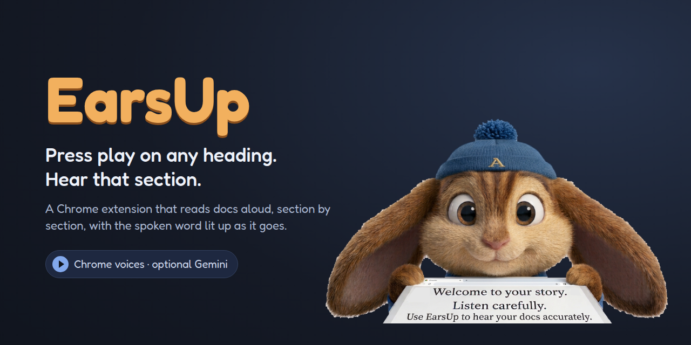
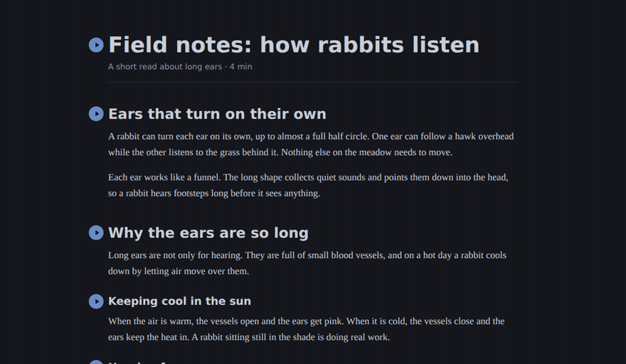
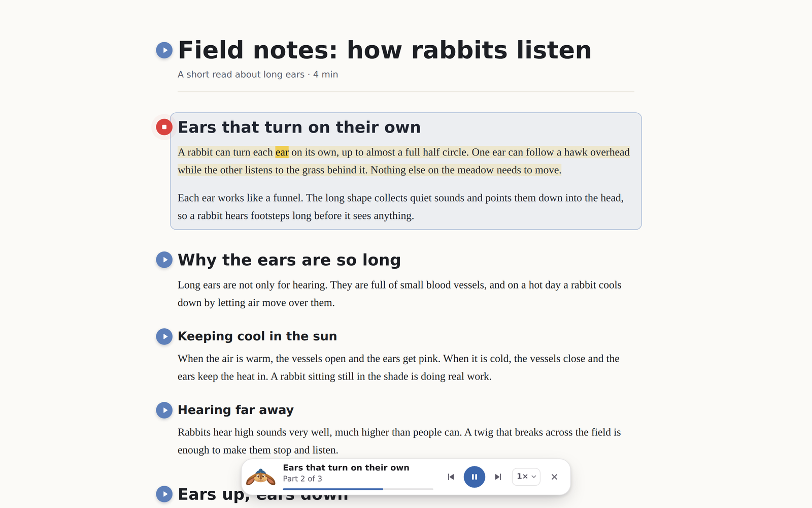
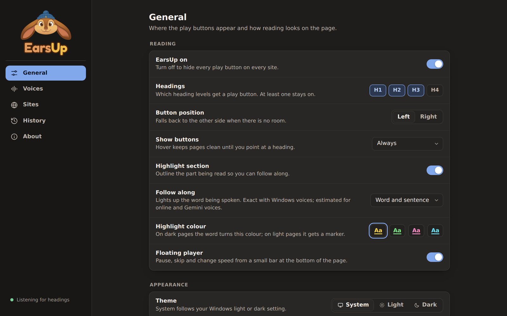
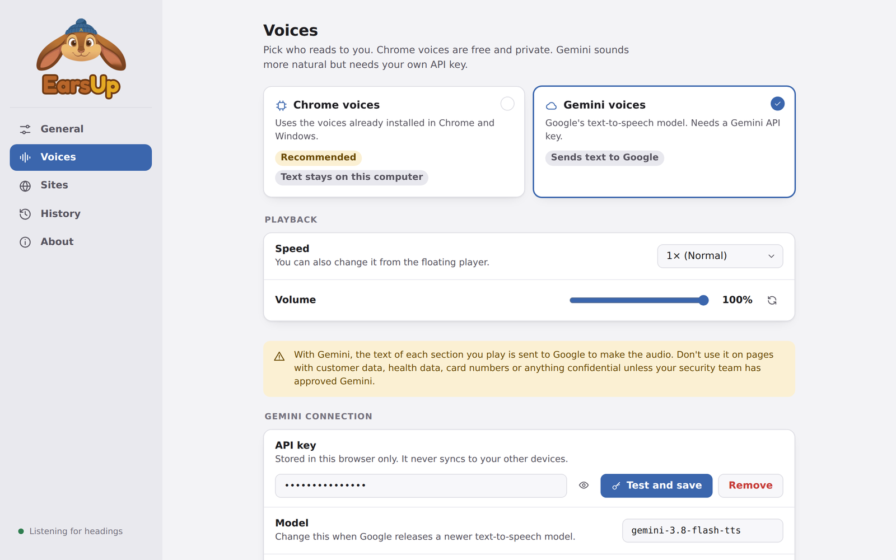
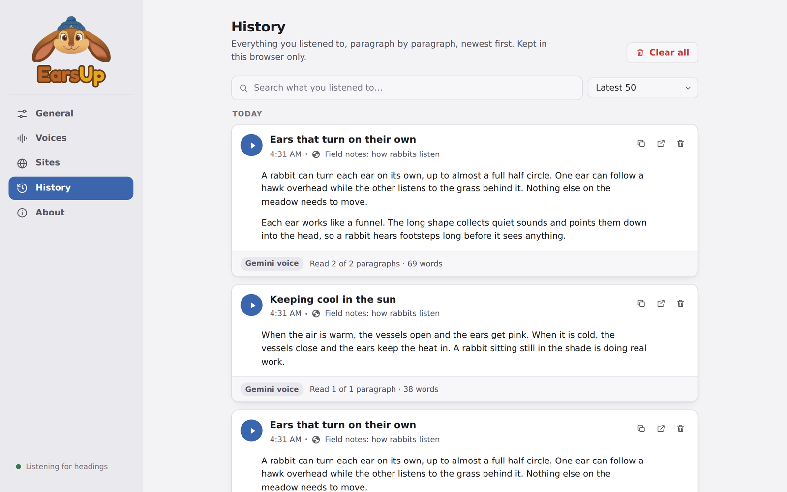
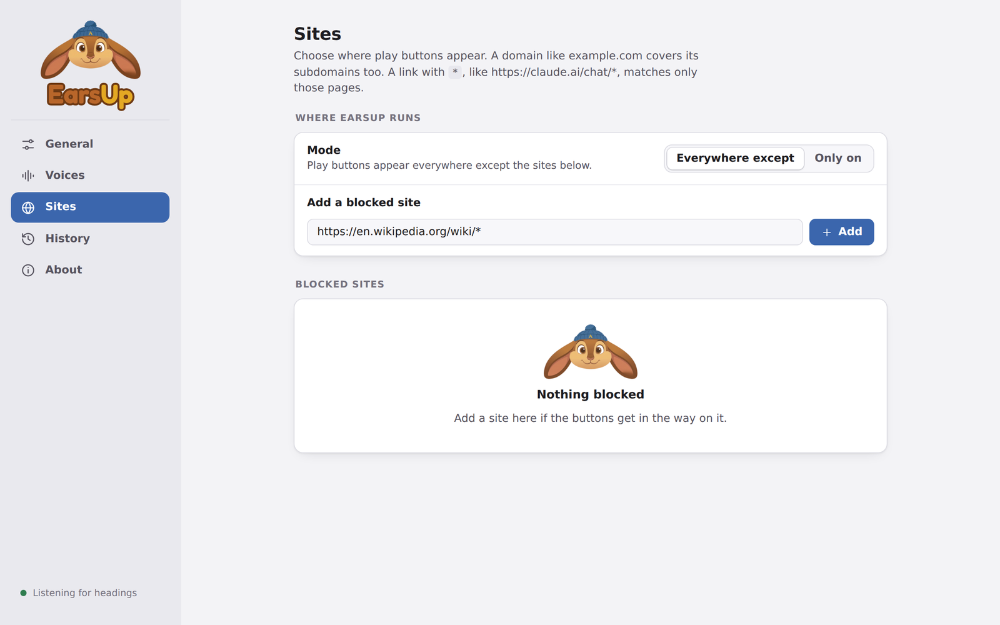

<p align="center">
  
</p>

<p align="center">
  <a href="https://github.com/lovestaco/earsup/releases/latest"></a>
  <a href="https://lovestaco.github.io/earsup/"></a>
  <a href="LICENSE"></a>
</p>

A Chrome extension that puts a play button next to every heading. Press it and EarsUp reads that section aloud, with the spoken word lit up as it goes.

Made for long docs, specs, wikis, and chats: listen to the one part you need, not the whole page.

📖 **Docs:** https://lovestaco.github.io/earsup/

## Demo



## Install

1. Download `earsup-vX.Y.Z.zip` from the [latest release](https://github.com/lovestaco/earsup/releases/latest).
2. Extract it to a folder you will keep.
3. Open `chrome://extensions`, turn on **Developer mode**, click **Load unpacked**, and select the folder.
4. Pin EarsUp from the puzzle icon.

Works in Chrome, Edge, Brave, and other Chromium browsers. [Full install guide](https://lovestaco.github.io/earsup/installation/)

**Build from source:**

```bash
git clone https://github.com/lovestaco/earsup
cd earsup
npm install
npm run build   # then Load unpacked → dist/
```

## Features

| | |
|---|---|
| **Play buttons** | On H1–H4 headings on any site, even inside frames. Reads until the next heading of the same level. |
| **Floating player** | Pause, skip, speed (0.5×–2.5×), close. Drag it anywhere. |
| **Follow along** | Bright sentence, coloured word. Yellow, green, pink, or cyan, or off. |
| **Chrome voices** | Offline, free, and nothing leaves your computer. |
| **Gemini voices** | 30 natural voices with your own API key. Optional reading style. |
| **History** | Every paragraph you listened to. Search, replay, copy, and link back to the page. |
| **Sites** | Everywhere except a list, or only on a list. Wildcards like `https://claude.ai/chat/*`. |
| **Side panel settings** | Opens next to the page. Light and dark, tooltips on everything. |



## Keys

| Key | Action |
|-----|--------|
| `Space` | pause / resume |
| `Esc` | stop (changeable to `Shift+Esc` or off) |
| `Alt+Shift+P` | pause / resume from anywhere |
| `Alt+Shift+S` | stop from anywhere |

## Settings

<p>
  
  
</p>
<p>
  
  
</p>

## Privacy

- **Chrome voices:** EarsUp sends nothing anywhere.
- **Gemini voices:** the text of each section you play goes to Google's Gemini API with your key. Do not use it on confidential, customer, health, or payment data unless your organisation allows it.
- Settings sync with Chrome. Your Gemini key and history stay in this browser only.

[More on privacy](https://lovestaco.github.io/earsup/privacy/)

## Development

```bash
make build      # type-check and build into dist/
make dev        # rebuild on save
make install    # bump patch version, build, copy to the folder Chrome loads
make package    # zip dist/ into release/earsup-vX.Y.Z.zip
make docs       # serve the docs locally
make release VERSION=v1.2.3   # tag + publish a GitHub release with the zip
```

See [Development](https://lovestaco.github.io/earsup/development/) for the layout and how reading works.

## Stack

- [React](https://react.dev) + [Vite](https://vitejs.dev) + TypeScript: settings panel
- Chrome Manifest V3: content script, service worker, side panel
- [Web Speech API](https://developer.mozilla.org/en-US/docs/Web/API/Web_Speech_API) and [Gemini TTS](https://ai.google.dev/gemini-api/docs/speech-generation): voices
- [CSS Custom Highlight API](https://developer.mozilla.org/en-US/docs/Web/API/CSS_Custom_Highlight_API): follow-along without touching the page

---

## since your ears are up — check out what I'm really building

I'm Maneshwar, and alongside EarsUp I'm building [git-lrc](https://github.com/HexmosTech/git-lrc?utm_source=earsup) — a micro AI code reviewer that runs on every commit.

It hooks into `git commit`, reviews every diff before it lands, and catches the bugs AI agents introduce silently. 60-second setup.

AI agents write code fast.

They also silently remove logic, change behavior, and introduce bugs — without telling you.

You often find out in production.

git-lrc fixes this.

Any feedback or contributors are welcome.

⭐ [Star git-lrc on GitHub](https://github.com/HexmosTech/git-lrc?utm_source=earsup) to help other devs discover it.
